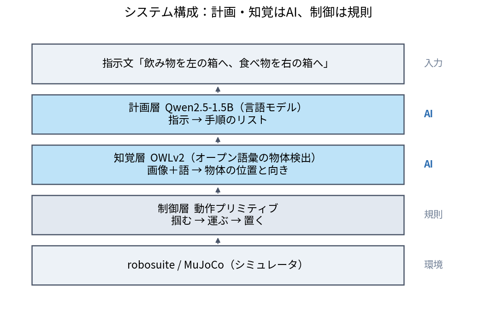
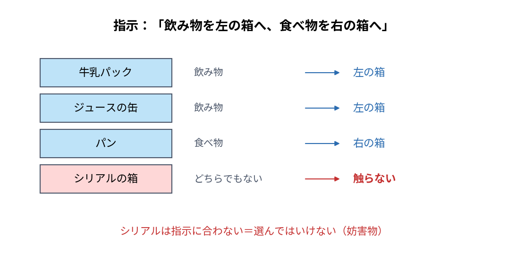
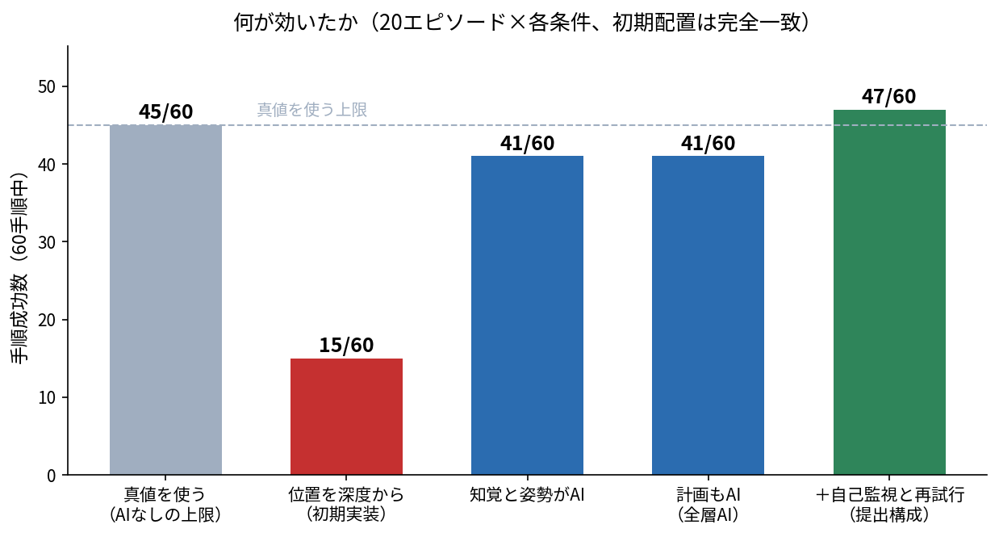
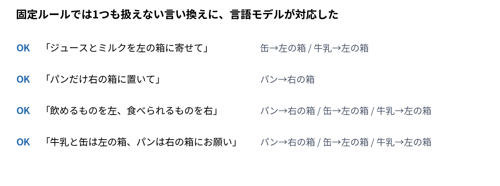

# あいまいな日本語の指示で卓上を仕分けるロボット

Physical AI 応用1講座 最終課題の提出物です。
**計画・知覚・把持姿勢のすべてをAIが担当**し、シミュレータの内部状態（真値）を一切使わずに動きます。



---

## 何をするか

> 指示：**「飲み物を左の箱へ、食べ物を右の箱へ」**

卓上には牛乳パック・パン・シリアルの箱・ジュースの缶があります。
ロボットはカメラ画像と指示文だけから、**指示に合う物だけ**を選んで運びます。

**シリアルの箱は妨害物**です。指示のどのカテゴリにも当てはまらないため、選んではいけません
（かつグリッパの開口幅を超えるので物理的にも掴めません）。



---

## 結果（20エピソード＝60手順）

| 条件 | 手順成功 | 対象の同定 |
|---|:-:|:-:|
| 真値を使う（AIなしの上限） | 45/60 | — |
| **全層AI（提出構成）** | **41/60** | **53/60（88%）・取り違え0件** |

**真値をすべてAIに置き換えても、上限の 91% の性能を維持します。**



固定ルールでは扱えない**言い換え4種すべて**に対応します。



---

## 使っているAI（いずれも**推論のみ。学習はしていません**）

| 層 | モデル | 役割 |
|---|---|---|
| 計画 | `Qwen/Qwen2.5-1.5B-Instruct` | 指示文 → 手順のリスト（JSON） |
| 知覚 | `google/owlv2-base-patch16-ensemble` | 画像＋語 → 物体の位置 |
| 姿勢 | （古典的画像処理） | 深度から物体の上面を取り、向きを求める |

---

## 動かし方

```bash
# 依存: robosuite 1.4.1 / mujoco 3.7 / torch / transformers
export SSL_CERT_FILE=/etc/ssl/certs/ca-certificates.crt HF_HUB_DISABLE_XET=1

# 全層AIで動かす（画面が無い環境でも動きます）
MUJOCO_GL=egl python scripts/run_episode.py \
    --episodes 5 --planner llm --perception model --yaw-source model \
    --camera-size 512 --tag demo

# アブレーション（7条件 × 20エピソード）
MUJOCO_GL=egl python scripts/run_ablation.py --episodes 20
```

出力は `outputs/<run_id>/` に動画・イベントログ・指標・設定として残ります。

---

## 構成

```
src/
  planning/llm_planner.py     計画層（言語モデル）
  perception/owlvit_detector.py  知覚層（検出・3D変換・向き推定）
  control/primitives.py       制御層（掴む/運ぶ/置く）
  envs/pickplace.py           シーン定義・物体の幾何
  pipeline.py                 3層を繋ぐ実行本体
  eval.py                     指標の集計（検算つき）
scripts/                      実験と検証の道具
experiments/                  実験ごとの記録（仮説・条件・結果・言えないこと）
docs/20_設計/                 システム設計・評価設計
docs/30_評価/                 確定した数値
```

---

## 工夫した点（詳細は [docs/30_評価/](docs/30_評価/)）

| # | 内容 | 効果 |
|:-:|---|---|
| 1 | 位置を深度画像でなく**視線と物体の中心高さ平面の交点**で求める | 手順成功 15/60 → **40/60** |
| 2 | 向き推定に**上面付近の点だけ**を使う | 誤差中央値 25.3度 → **1.8度** |
| 3 | 卓上を**切り出して**から検出する | 同定 55% → **90%** |
| 4 | 計画層の出力を**基準順へ並べ替える** | 手順成功 29/60 → **41/60** |

いずれも**ランダムや対照条件と比べて確かめた**結果です。

---

## 限界（正直に）

- **把持の失敗が律速**です（60手順中10件）。真値を使っても9件起きるため、AIとは無関係です。
- **向き推定は物体の上面が見えることが前提**です。見えない配置では成立しないはずですが、確かめていません。
- 運ぶ順番が最良である**理由は解明していません**。実測で選んでいます。
- シミュレータ（robosuite `PickPlace`）のみで検証しています。
