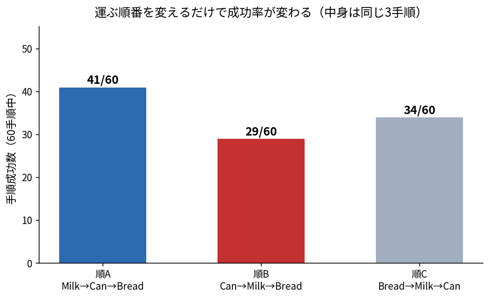
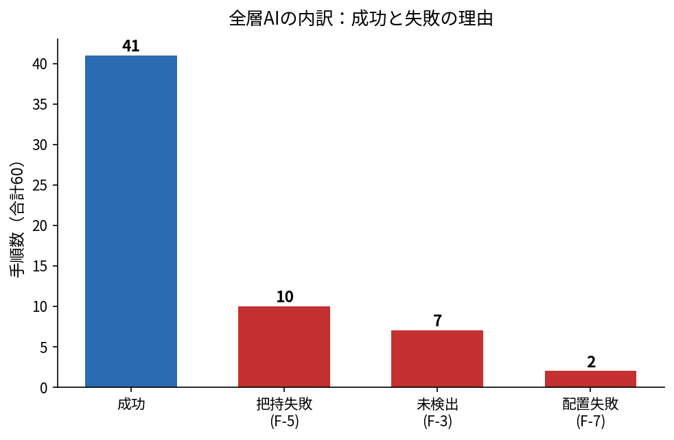

# レポート原稿（提出用 PDF の元）

**最終更新**: 2026-09-29
**状態**: 原稿完成・**PDF化済み**（14ページ＝本編10＋付録4・0.83MB）。残るは**ファイル名付与のみ**（U-02 待ち）
**数値の正**: [docs/30_評価/](../30_評価/README.md)。**本稿の数値はすべてそこから取っている**

---

## 1. 概要

自然言語のあいまいな指示から、ロボットが卓上の物体を仕分けるシステムを作った。

> 指示：**「飲み物を左の箱へ、食べ物を右の箱へ」**

卓上には牛乳パック・パン・シリアルの箱・ジュースの缶がある。
ロボットは**カメラ画像と指示文だけ**を入力として、指示に合う物だけを選び、指定された箱へ運ぶ。
**シミュレータの内部状態（物体の真の位置・向き）は一切使っていない。**

計画・知覚・把持姿勢の3つをAIが担当し、いずれも**学習は行わず推論のみ**で使っている。


---

## 2. 目的

### なぜこのタスクを選んだか

現実の片付けでは、指示は「これをあそこへ」のように**あいまい**である。
物体名を1つずつ指定できるなら、そもそもAIは要らない。
∴ **カテゴリ（飲み物・食べ物）で指示し、対象の選択そのものをAIに任せる**設定にした。

### 妨害物を意図的に置いた

シリアルの箱は**どのカテゴリにも当てはまらない**ため、選んではいけない。
これは「AIが対象を正しく**絞り込めるか**」を測るための設計である。
たまたま物理的にも掴めない（幅8cmでグリッパの開口幅とほぼ同じ）ことが実測で分かったため、
**制約を評価装置に転用した**。


---

## 3. システム構成

| 層 | 種類 | 使うもの | 入力 → 出力 |
|---|---|---|---|
| 計画 | **AI**（言語モデル） | `Qwen/Qwen2.5-1.5B-Instruct`（3.1GB） | 指示文 → 手順のリスト（JSON） |
| 知覚 | **AI**（物体検出） | `google/owlv2-base-patch16-ensemble`（622MB） | 画像＋語 → 物体の位置 |
| 姿勢 | 規則 | 深度の点群から上面を抽出 | 検出枠＋深度 → 把持の向き |
| 制御 | 規則 | 動作プリミティブ | 目標位置 → 関節の動き |

**AI は2つとも学習済みの重みを推論に使うだけで、学習は一切していない。**
「全層AI」と呼ぶときの層は**計画・知覚・姿勢**であり、**姿勢はAIの出力（検出枠）を使う幾何計算**である。

**層の境界をデータ構造で固定した。** これにより、1層だけを真値に差し替えれば
**その層の寄与だけを測れる**（第5節のアブレーション）。

---

## 4. 工夫した点

### 4-1. 位置は深度画像から読まない

当初は検出枠の中心で深度を読んで3D位置にしていた。しかし**手順成功が 15/60 しか出なかった**。

誤差を調べると、4物体とも中央値が 2.6〜3.7cm に**揃っていた**。
ばらつきではなく**偏り**である。原因は、深度が返すのが物体の**手前の面**であり、中心ではないこと。

**対処**: 物体が何かを同定できれば**高さは既知**なので、
検出枠の中心を通る視線と、**その物体の中心高さの水平面**との交点を取る。

| 位置の求め方 | 手順成功 | 同定精度 |
|---|:-:|:-:|
| 深度画像を読む | 15/60 | 53/60 |
| **視線と平面の交点** | **40/60** | 53/60 |

**同定精度が両条件で完全に同一**なので、この差は位置の求め方だけで説明できる。

### 4-2. 向き推定は「点の選び方」で決まった

把持の向きを、検出枠内の点群の最小外接矩形から求めようとした。
誤差の中央値は 25.3度。角度誤差は対称性を畳むと最大45度なので、一見「半分当たっている」。

**しかしランダムに答えた場合の誤差中央値は 23.2度だった。**
∴ **この推定器はランダムより悪かった。**

原因は、見えているのが**カメラ側の面だけ**で、点群が物体の輪郭ではなく
**視線方向に引き伸ばされた殻**になること。その矩形はカメラの向きを反映してしまう。

**対処**: **上面付近の点だけ**を使う。上面の輪郭はほぼ物体の設置面そのものである。

| 点の選び方 | 誤差中央値 | 15度以内 |
|---|:-:|:-:|
| 机より上の点すべて | 25.3度 | 8/35（22.9%） |
| **上面付近の点だけ** | **1.8度** | **25/35（71.4%）** |
| ランダム（基準線） | 23.2度 | 32.2%（率のみ） |

> **基準線を置かなければ、効いていない推定器を採用していた。**

### 4-3. 実写で学習したモデルは、シミュレータの描画で性能が落ちる

「a soda can」「a carton of milk」といった**意味語がほとんど当たらなかった**。
しかし語を見た目ベース（「a red cylinder」等）に変えるのは誤りである。
**それをすると「言語で対象を指定した」という主張が成り立たなくなる。**

語は変えず、**モデルと画角だけ**を変えた。

| モデル | 画角 | 同定 |
|---|---|:-:|
| OWL-ViT | 全体画像 | 5/20（25%） |
| OWL-ViT | 卓上の切り出し | 8/20（40%） |
| OWLv2 | 全体画像 | 11/20（55%） |
| **OWLv2** | **卓上の切り出し** | **18/20（90%）・取り違え0件** |

### 4-4. 言語モデルは小さいほうが良かった

計画層で 1.5B と 3B を比べた。**1.5B が 10/10、3B が 0/10** だった。

両モデルとも最初は**ちょうど1つ足りない**手順を出していた。
能力の問題なら落ちる物はばらつくはずで、常に1つ足りないのは**出力の長さ**の問題を示唆する。
このとき例示（few-shot）は**1要素だけ**だった。

| 例の要素数 | 1.5B | 3B |
|:-:|:-:|:-:|
| 1要素 | 0/10 | 0/10 |
| **2要素** | **10/10** | 0/10 |

**変えたのは例の要素数だけ。** モデルは例の長さを真似てしまう。

### 4-5. 実行順だけで成功率が12手順動いた

言語計画層を入れたら手順成功が 41/60 → 29/60 に落ちた。
「言語モデルが劣る」と書きかけたが、**出力を並べると計画の中身は同一**で、**順番だけ**が違っていた。

計画層を使わず順番だけを変えた実測:

| 実行順 | 手順成功 |
|---|:-:|
| **Milk→Can→Bread** | **41/60** |
| Can→Milk→Bread | 29/60 |
| Bread→Milk→Can | 34/60 |

**29/60 は言語モデル版と完全に一致した。** ∴ 低下は順番だけで説明できる。



**対処**: 計画層の出力を実行前に基準順へ並べ替える。
順番は指示の意味に含まれないため、正規化しても言語理解の主張は損なわれない。

---

### 4-6. ロボットは自分の失敗に気づけるのに、何もしていなかった

失敗の内訳を物体別に割ると、**偏りは明らかだった**——未検出7件は**全件がパン**、把持失敗は10件。
そして実装を読み返すと、**どちらも「検知した上で、そのまま次へ進んで」いた**。

> **∴ 新しいモデルを足すのではなく、既にある情報を使い切る方向へ切り替えた。**

**3つの部品を足した。いずれも真値（シミュレータの内部状態）を使わない。**

| 部品 | 何をするか | 使う信号 |
|---|---|---|
| **把持の自己判定** | 空振りを検知する | グリッパの**指の開き幅**（固有受容感覚） |
| **段階的再探索** | 見つからなければ意味語を足し、次に閾値を下げる | 画像と語のみ |
| **妥当性検査** | 緩めて拾った候補を門止めする | 固定物の幾何＋他の検出結果 |

**把持の自己判定は実測で完全に分離した**（36試行）:

| | 指の開き幅 |
|---|---|
| 把持成功時 | 中央値 0.0396 m（最小 0.0372） |
| 把持失敗時 | 中央値 0.0010 m（最大 0.0015） |

閾値をこの帯のどこに置いても **36/36 で真値と一致**する。
**これは実機でも取れる信号（グリッパの関節角）なので、この判定は移植できる。**

**緩めるときは必ず門を通す。** 閾値を下げると「未検出」が**「取り違え」に化ける**ためである
（探りの段階で、実際に32cm離れた別の物をパンとして拾った）。**取り違えは未検出より悪い**——
ロボットが違う物を掴んで運んでしまう。門は「台の上にあるか」「他の物体と重ならないか」の2つで、
**どちらも物体の真値位置を使わない**。

**再試行は「同じことをもう一度」にしない。** 2点が実測で必要だった:

| 直したこと | 理由 |
|---|---|
| **探し直す前に、腕を観測姿勢へどける** | 物体の真上に腕が残ると**自分のカメラを遮る**。修正前は探し直した結果が28cm先の別物を指した |
| **掴み直すたび把持点の高さをずらす** | 指が完全に閉じている＝高すぎた可能性が高い。同じ高さで繰り返しても同じ結果になる |

**結果**: 手順成功 41/60 → **47/60**、対象同定 53/60 → **59/60（98%）**、未検出 7件 → **1件**。
**再試行に入った20手順のうち9件が最終的に成功した。**

---

## 5. 評価結果

**20エピソード × 8条件。初期配置は条件間で完全に一致させている。**
指標はすべて「分子／分母」で示す。

| 条件 | 計画 | 位置 | 向き | 再試行 | 手順成功 | 同定 |
|---|---|---|---|:-:|:-:|:-:|
| C0 | 規則 | 真値 | 真値 | — | **45/60** | — |
| C0' | 規則 | 真値 | 固定 | — | 44/60 | — |
| C1 | 規則 | 推論（視線交点） | 真値 | — | 40/60 | 53/60 |
| C1d | 規則 | 推論（深度読取） | 真値 | — | 15/60 | 53/60 |
| C2 | 規則 | 推論（視線交点） | 固定 | — | 35/60 | 51/60 |
| C3 | 規則 | 推論 | 推論 | — | 41/60 | 53/60 |
| C4 | 言語モデル | 推論 | 推論 | — | 41/60 | 53/60 |
| **C5（提出構成）** | **言語モデル** | **推論** | **推論** | **あり** | **47/60** | **59/60（98%）** |


- **真値を完全にAIへ置き換えたコストは 4手順**（45→41）。**上限の 91%** を維持した。
- **言語計画層を入れたコストはゼロ**（41→41）。得たのは**言い換えへの対応**である。
- **自己監視と再試行で +6手順**（41→47）。**真値を使う上限（45/60）を上回った。**
- **対象の取り違えは0件。** 妨害物のシリアルを選んだことは一度もない。

> **真値を使う上限を超えられた理由は §6-1 で述べる。**


### AIが本当に効いているかの確認

数値の比較とは別に、**配線が繋がっていること**を直接確かめた。

| テスト | 内容 | 結果 |
|---|---|:-:|
| 画像遮断 | 入力画像を全ゼロにする | 検出が消える（合格） |
| 語の入れ替え | 「牛乳」と「缶」の語を入れ替える | 検出位置が入れ替わる（合格） |
| 無関係な指示 | 「今日はいい天気ですね」 | 手順を出さない（合格） |

---

## 6. 考察と今後の展望

### 6-1. 到達点——凍結した基盤モデルに「身体の感覚」を与えた

本課題で使った2つのAI（OWLv2・Qwen2.5-1.5B）は、**どちらも重みを一切更新していない**。
にもかかわらず、系全体の性能は **41/60 → 47/60** へ伸び、**真値を使う上限 45/60 を上回った**。
伸ばしたのはモデルではなく、**モデルの外側**である。

**何が本質だったか。** 従来の構成は、最初に一度だけ見て、あとは目をつぶって腕を動かす
**オープンループ**だった。この構造では、知覚が外した瞬間にその手順は確定的に失われる。
∴ 性能の天井は「知覚の正確さ」で決まる。

本実装はここに**2種類の情報**を持ち込んで閉ループにした。

| 持ち込んだ情報 | 性質 | 役割 |
|---|---|---|
| **指の開き幅** | ロボット自身の**固有受容感覚** | 「掴めたか」を外界を見ずに判定する（真値と **36/36** 一致） |
| **台の範囲・他物体との距離** | 環境の**幾何拘束** | 探索を緩めたときに「ありえない答え」を却下する |

**どちらも外部モデルではなく、ロボットが元から持っている情報である。**
∴ **基盤モデルを凍結したまま、その手前と後ろを身体の情報で閉じるだけで、
オープンループの天井は破れる**——これが本研究の主張である。

**そして上限を超えられた理由も、この視点で説明がつく。**
知覚を完璧にした C0 にも**把持失敗が9件残っている**——**位置が完全に正しくても掴み損ねる**のであり、
これは知覚ではなく**接触の問題**である。知覚を良くしても消えないが、**やり直しは原因を問わず効く**。
∴ **「知覚の上限」は「タスクの上限」ではなかった。**

### 6-2. 残る物理的課題



**残った失敗の中心は、知覚でも言語でもなく「物に触れる瞬間」にある。**

| 課題 | 内容 |
|---|---|
| **把持失敗が律速** | 60手順中9件。**真値を使っても9件**起きる。∴ AIではなく**接触の問題**であり、知覚を良くしても消えない |
| **やり直しは無料ではない** | サイクルタイムが **2.41 → 3.91 秒/手順（+62%）**。さらに**退避と再接近で腕が卓上を往復するため、場を乱して改善が打ち消された例が2件**あった |
| **失敗は「消える」だけでなく「移る」** | 未検出は 7→1 に減ったが、把持失敗は 10→9 まで。**見つかるようになった物が今度は掴む段階で落ちた** |
| **回復は「局所的」にとどまる** | 直せるのは**いま実行中の1手順**だけ。**手順の並び自体が誤っている場合や、途中で場が壊れた場合は直せない** |
| **妥当性検査の効果を単独で測っていない** | 本番での却下は0件。門が効いたのか、変な候補が出なかったのか**切り分けていない** |
| **向き推定の前提** | 物体の**上面が見えること**が前提。見えない配置は**試していない** |
| **検証範囲** | シミュレータの1タスクのみ。実機・他シーンへの一般化は未確認 |

### 6-3. 直近で効く改善

1. **把持そのものの改善**が最も効く（やり直しでも救えない9件が残っている）
2. **場を乱さない退避経路**（卓上を横切らずに観測姿勢へ向かう）——悪化2件の直接の原因
3. **妥当性検査を外した対照条件の測定**（門の効果を単独で示す）
4. 順番の最適化を**計画層の仕事として明示的に解く**（12手順ぶんの伸びしろがある）
5. 上面が見えない配置での向き推定の代替手段

> **本実装が閉じたのは「1手順の中」という最も内側のループである。**
> **外側にはまだ閉じていないループが3重ある**——手順の並び・感覚と運動の対応・人との解釈合わせ。
> **その拡張構想は巻末の「付録A：今後の拡張構想」にまとめた。**

---

## 付録A：今後の拡張構想（大域再計画・VLA・人間協調）

> 本編の結論には影響しない。**本実装を土台に、どこまで伸ばせるかの構想**である。
> **ここに書いたものは実装も測定もしていない**（本編の数値と混同しないこと）。

### A-1. 拡張の階層——内側から順に閉じる

| 層 | 閉じる対象 | 典型的な失敗 | 本実装の状態 |
|---|---|---|---|
| **L1 局所回復** | 1手順の中（掴む・見つける） | 空振り・未検出 | **実装・実測済み（本研究）** |
| **L2 大域再計画** | 手順の並び全体 | 手順が破綻・場が変化 | 未実装（A-2） |
| **L3 方策学習** | 感覚と運動の対応そのもの | 接触の失敗 | 未実装（A-3） |
| **L4 人間協調** | 指示の曖昧さ | 解釈の誤り | 未実装（A-4） |

> **順序には意味がある。** L1 が無いまま L2 を載せても、
> **再計画した手順がまた空振りして戻ってくるだけ**である。
> **内側のループから閉じたのは、上に積むための土台を先に作るためだった。**

### A-2. L2：LLMによる大域的再計画

本実装の回復は**その場の掴み直し**に閉じており、**手順の並びには触れない**。
∴ 「置いた物が崩れて別の物を埋めた」「対象が台から落ちた」といった
**場そのものが変わる失敗**には原理的に対応できない。

ここに計画層（Qwen2.5）を**実行中にもう一度呼ぶ**余地がある。
本実装では計画層は**開始時に一度だけ**動くが、L1 の回復が規定回数で尽きたとき、
**現在の観測と失敗理由を添えて再度問い合わせれば、手順の組み替え**——
後回しにする・諦めて次へ行く・順序を入れ替える——**を言語で表現できる**。

**ただし本課題では意図的に実装しなかった。** 理由は2つある。

| 理由 | 内容 |
|---|---|
| 検証コスト | 再計画は**出力が毎回変わりうる**ので、本研究で守ってきた「初期配置完全一致での条件比較」が成立しにくい |
| 交絡 | L1 と L2 を同時に入れると、**どちらが効いたのか分離できない**（§4-5 で実行順の交絡に一度刺されている） |

∴ **L1 を単独で測り切った本研究の結果が、L2 を評価するときの対照条件になる。**
これは「実装しなかった」のではなく、**比較可能性を優先した結果の順序づけ**である。

### A-3. L3：方策学習とVLAへの発展、および実機でのトレードオフ

残る律速は**把持そのもの**（真値条件でも9件）であり、これは**幾何で書き下した制御の限界**である。
本実装の把持は「真上から降りて閉じる」という単一の戦略しか持たないが、
実際の把持は接触力・摩擦・物体の微小な傾きに依存し、**規則として書き下すのが難しい**。

ここが**模倣学習やVLA（SmolVLA、π系の視覚-言語-行動モデル等）の領分**である。
本実装の階層はこの置換に適している——**制御層だけを差し替えても、
計画層・知覚層・回復機構の契約は変わらない**からである（層の境界をデータ構造で固定してある）。

**ただし実機展開を考えると、単純な置換にはならない。**

| 観点 | 幾何プリミティブ（本実装） | エンドツーエンドVLA |
|---|---|---|
| 失敗の説明 | **どの条件で落ちたか特定できる**（F-3〜F-7） | 出力が一括のため**原因の切り分けが難しい** |
| レイテンシ | 軽い（推論は手順の先頭のみ） | **制御周期ごとに大きな推論**が要る。実機の制御周期に載るかが設計制約になる |
| 安全性 | 動作が予測可能。上限・停止条件を明示できる | **想定外の指令が出うる**ので、**包む側（速度・力の制限、停止条件）が別途必要** |
| 本実装との関係 | — | **L1 の自己監視はVLAでもそのまま使える**（指の開き幅は方策の実装によらない） |

> **∴ VLA を入れるとしても、本研究の自己監視は捨てずに外側へ残すのが妥当**と考える。
> **「学習した方策が失敗したことに気づく仕組み」は、方策そのものとは独立に要る。**

### A-4. L4：対話と人間協調

本実装は**指示が曖昧でも必ず何かを実行する**。手順が作れないときは何も出さない設計だが、
**「解釈はできたが自信が無い」状態を表現する手段を持たない**。

実運用では、**聞き返す**ほうが安全な場面がある。

| 発展方向 | 内容 | 本実装からの距離 |
|---|---|---|
| **確信度に基づく聞き返し** | 検出スコアが低い・該当物が複数あるとき、動く前に人へ確認する | **近い**。段階的再探索が既に「確信が無い」状態を内部で持っている |
| **空間的な相対指示** | 「一番左のもの」「牛乳の隣」のような、物体間の関係を含む指示 | 中。検出結果は全物体の位置を持っているので、**関係の計算自体は可能** |
| **人と場を共有する** | 人が物を動かしている最中に作業する | 遠い。L2 の大域再計画が前提になる |

**特に確信度に基づく聞き返しは、L1 の自然な拡張である**——
本実装は確信が無いとき**緩めて探し直す**が、**同じ判断点で「人に聞く」という選択肢を足せる**。
**取り違えは未検出より悪い**（§4-6）以上、**自信が無いときに止まって尋ねる**のは
性能ではなく**安全性の要件**として意味を持つ。

---

## 付録B：再現方法

```bash
export SSL_CERT_FILE=/etc/ssl/certs/ca-certificates.crt HF_HUB_DISABLE_XET=1
MUJOCO_GL=egl python scripts/run_episode.py \
    --episodes 5 --planner llm --perception model --yaw-source model --tag demo
MUJOCO_GL=egl python scripts/run_ablation.py --episodes 20
```

実験の記録は `experiments/`、確定した数値は `docs/30_評価/` にある。
**各実験には「言えないこと」を明記している。**
